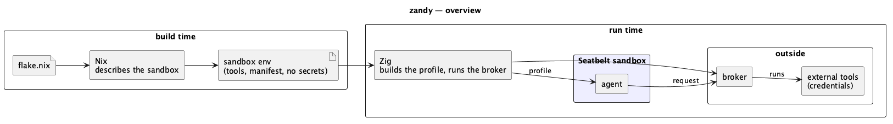

# Zandy Design

A macOS sandbox launcher with builtin profiles for well-known apps, built around Nix.

## API

```
zandy --env <drv> [args...]   # run the env's preset in its sandbox, with the broker
zandy config --env <drv>      # print the manifest and the methods the agent sees
zandy --env <drv> --zandy-config  # the same, as zandy-<name> --zandy-config from the launcher
zandy --help
```

## Presets

A preset is the minimum correct set of sandbox permissions an app needs to function, plus what zandy passes to it: `binary`, `env` allowlist and startup `args`. Presets are Nix files under `nix/presets/`; `mkSandboxEnv` writes the chosen one into the env's `zandy.json`.

Presets are always required — there is no raw mode. Without a preset, the sandboxed process would crash or hang because the user can't know which mach lookups, IPC, or system operations an app requires.

## Nix, Zig and Seatbelt

Nix decides what goes into a sandbox, at build time. Zig turns that into a sandbox profile and runs the broker. Seatbelt, the macOS kernel sandbox, enforces the profile.



**Nix describes the sandbox.** It decides which tools live inside, which stay outside behind the broker, and what the agent may ask for. The result is reproducible, read-only and holds no secrets.

**Zig connects the two.** It translates what Nix described into a Seatbelt profile, brings in secrets only outside the sandbox, and mediates every request that crosses the boundary.

**Seatbelt enforces it.** The kernel confines the agent to that profile: what it may read, write, execute and connect to. Once applied, the agent can't loosen it.

## Broker

The sandboxed agent gets no credentials. When it needs an external tool (e.g. `glab`), it asks the broker over a Unix socket, and the broker runs the command outside the sandbox.

### Request flow

```
zandy-client call aws.cli '{"profile":"acme-dev","args":["s3","ls"]}'
  → {"jsonrpc":"2.0","id":1,"method":"aws.cli","params":{"ticket":"…","args":{"profile":"acme-dev","args":["s3","ls"]}}}
broker: ticket → find → parseParams → buildArgv → run
  ← {"jsonrpc":"2.0","id":1,"result":"<stdout>"}   or   {"error":{"code":-32002,"message":"<stderr>"}}
```

`rpc.discover` returns every callable method with its description and a JSON schema of its params.

### Decisions

- **Adapters group capabilities.** An adapter holds the shared `binary`, `env` and name prefix; each capability adds `params` and an `argv` template.
- **Parse, don't validate.** Config and requests are parsed into precise types; `buildArgv` only accepts those.
- **No shell.** Each placeholder is a whole argv entry. `string` params can't start with `-`, `list` params can, `choice` params only take configured values.
- **The outer process sets the scope.** The broker doesn't judge commands; token scopes and IAM permissions do.
- **Backend credentials come from the broker.** The claude preset fetches its Bedrock credentials through the `backend.credentials` adapter.
- **No secrets in the sandbox.** The manifest holds env names, values come from zandy's environment. The sandbox gets only its preset's `env` plus `BROKER_SOCK`/`BROKER_TICKET`; adapter binaries stay outside its closure.
- **Exec allowlist.** Only the env's closure may be executed, plus `/bin/sh` and `/bin/bash` for claude.
- **Protected files.** The working directory is writable, except `flake.nix`, `flake.lock`, `.envrc`, `.git/config` and `.git/hooks`.
- **Network is narrowed.** Only TCP to `*:443`, DNS and the broker socket.

## Known issues

- git aborts with `unable to access '~/.config/git/config': Operation not permitted`: the presets don't allow reading the global git config.
- Keep `AWS_PROFILE` out of the `env` block of `~/.claude/settings.json`, otherwise claude tries to resolve it inside the sandbox.
- `glab auth login` stores its token in `~/.config/glab-cli/config.yml`. The presets don't allow reading it; keep it that way, or the agent can bypass the broker.
- `opencode` fails with `operation not permitted mkdir '/var/folders/…'`: start it once without zandy, then with zandy.
